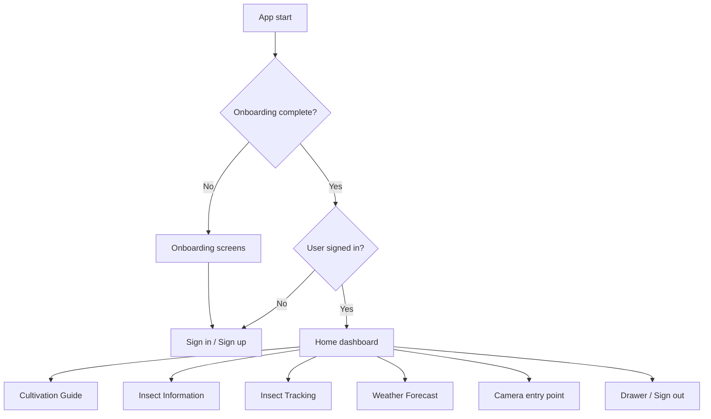

# Cropix

**A Flutter field companion for pechay (Bok Choy) growers — pest reference, cultivation guidance, insecticide tracking, and weather-aware spray planning.**

[](https://flutter.dev)
[](https://firebase.google.com)
[](https://openweathermap.org)
[](#project-status)

> **Project status:** Cropix is under active development. This repository currently tracks only the Dart source in `lib/` and this README. `pubspec.yaml`, platform folders, image/Lottie assets, tests, and Firebase rules are not committed yet. See [Getting started](#getting-started) to reconstruct a runnable project.

---

## Overview

Cropix brings the day-to-day decisions of smallholder vegetable farming into one mobile app. It was designed around lowland pechay production in the Philippines; the cultivation content references growing conditions in **Tagum City**.

With Cropix, a grower can:

- Learn how to recognize common pechay pests and what to do about them.
- Follow a stage-by-stage cultivation guide from seedling to harvest.
- Record which insect and insecticide were used, and in what amount.
- Check local weather and get a simple warning about whether it is a good time to spray.
- Keep a profile and share farming notes with other growers (community module in progress).

## Features

| Area | What it does | Status |
| --- | --- | --- |
| **Onboarding** | Four-page introduction to pest classification, prevention, tracking, and growing guides. Completion is stored with `shared_preferences`. | Implemented |
| **Authentication** | Email/password sign-in and sign-up, Google sign-in, and password reset email via Firebase Auth. | Implemented |
| **Home dashboard** | Current local weather, quick-access cards for the guide, pest library, tracker, and forecast, plus a camera entry point. | Implemented |
| **Pest library** | Illustrated pages for **aphids, armyworm, cutworm, diamondback moth, and leafminer** with scientific name, description, cause, life cycle, and preventive measures. Pages include a translation button, but the Bisaya copy is still placeholder text. | Implemented |
| **Cultivation guide** | Bok Choy overview, common varieties, and a detailed White Stem pechay guide covering pre-seedling, seedling, vegetative, flowering, and harvest stages. | Implemented |
| **Insect tracking** | Create insecticide-use records (insect type, insecticide, amount) and store them in Firestore. History and charts are still being built. | Partial |
| **Weather** | Current conditions on the home screen plus a 5-day / 3-hour forecast. Rain and thunderstorms trigger a "not ideal to spray" warning; clear and cloudy conditions are flagged as suitable. | Implemented |
| **Profile** | Shows the signed-in user's username and bio and allows bio editing. | Implemented |
| **Community** | Firestore-backed text posts intended as a farmer community feed. Feed UI is not finished and the screen is not linked from the drawer. | In progress |
| **Themes / settings** | Light and dark theme scaffolding exists but is commented out. | In progress |

> The pest library currently links to a **whitefly** page that has not been committed yet. See [Project status](#project-status).

## How the app flows



`Gate` checks the onboarding flag and Firebase's auth state stream, then routes the user to `OnBoardingView`, `SignInUp`, or `Home` accordingly.

## Tech stack

| Layer | Technology |
| --- | --- |
| App framework | Flutter / Dart |
| Authentication | Firebase Authentication (email/password and Google) |
| Database | Cloud Firestore |
| State management | `provider` (`FirebaseProvider` as a `ChangeNotifier`) |
| Weather | OpenWeatherMap current weather and 5-day forecast APIs |
| Local storage | `shared_preferences` |
| Location | `geolocator` + `geocoding` |
| Device features | `image_picker` (camera) |
| UI | Material 3, `google_fonts`, `flutter_svg`, `lottie`, `smooth_page_indicator`, `carousel_slider` |

## Project structure

```text
lib/
├── main.dart                     # App bootstrap, Firebase init, provider wiring
├── firebase_options.dart         # Generated FlutterFire configuration
├── authentication/
│   ├── auth.dart                 # Firebase Auth wrapper (email, Google, sign out)
│   ├── gate.dart                 # Onboarding + auth routing
│   └── signinup.dart             # Toggles between sign-in and sign-up
├── signs/
│   ├── signin.dart               # Sign-in form and Google button
│   └── signup.dart               # Registration form
├── onboardings/
│   ├── onboarding_info.dart      # Onboarding data model
│   ├── onboarding_item.dart      # Onboarding content
│   └── onboarding_view.dart      # PageView onboarding flow
├── pages/
│   ├── home.dart                 # Dashboard, current weather, camera entry
│   ├── cultivationguide.dart     # Bok Choy overview and variety cards
│   ├── insectinfo.dart           # Pest library grouped by growth stage
│   ├── weatherforecast.dart      # Forecast list and spray advisories
│   ├── track.dart                # Tracker shell
│   ├── user.dart                 # Profile and bio editing
│   ├── community.dart            # Community feed (work in progress)
│   ├── forgotpassword.dart       # Password reset
│   ├── insects/                  # Individual pest pages
│   └── pechay/                   # Stage-by-stage pechay guide
├── components/                   # Reusable buttons, fields, drawer, cards
├── firebase/
│   ├── provider.dart             # ChangeNotifier facade used by the UI
│   └── service.dart              # Firestore reads and writes
├── models/                       # UserProfile, Post, Track
├── themes/                       # Light/dark theme scaffolding (disabled)
└── weatherapi/                   # Current-weather model and service
```

Two weather clients coexist: `lib/weatherapi/` handles current conditions, while `lib/pages/weatherservice.dart` and `weathermodel.dart` handle the forecast.

## Firestore data model

| Collection | Document ID | Fields |
| --- | --- | --- |
| `Users` | Firebase Auth UID | `uid`, `name`, `email`, `username`, `bio` |
| `Posts` | Auto-generated | `uid`, `name`, `username`, `post`, `timestamp`, `likecount`, `likedby` |
| `Track` | Auto-generated | `uid`, `typeofinsect`, `typeofinsecticide`, `amount`, `date` |

## Getting started

### Prerequisites

- Flutter SDK 3.x (Dart 3)
- Android Studio or Xcode with an emulator/simulator or physical device
- A Firebase project
- A [FlutterFire CLI](https://firebase.google.com/docs/flutter/setup) setup
- An [OpenWeatherMap](https://openweathermap.org/api) API key

### 1. Get the source

```bash
git clone https://github.com/kyujuuuu/Cropix.git cropix-src
```

Because this repository does not include the Flutter project shell, create one and copy the app source into it:

```bash
flutter create --project-name cropix --org com.example cropix
cp -R cropix-src/lib/. cropix/lib/
cp cropix-src/README.md cropix/README.md
cd cropix
```

> On PowerShell, use `Copy-Item -Recurse -Force cropix-src\lib\* cropix\lib\` instead of `cp`.
> If you already have the original full project (with `pubspec.yaml` and platform folders), skip the scaffolding and use that instead.

### 2. Install dependencies

```bash
flutter pub add firebase_core firebase_auth cloud_firestore provider \
  google_fonts flutter_svg lottie smooth_page_indicator \
  shared_preferences image_picker geolocator geocoding http carousel_slider

# The current code uses the google_sign_in 6.x API.
flutter pub add google_sign_in:^6.2.0
```

If you want to finish the chart prototype in `lib/pages/code`, also add `fl_chart`.

### 3. Add the image and animation assets

The Dart code references paths such as `images/iconcropix.svg`, `images/aphids.webp`, and `images/weathersunny.json`. Create an `images/` folder at the project root, add the assets, and register the folder in `pubspec.yaml`:

```yaml
flutter:
  uses-material-design: true
  assets:
    - images/
```

<details>
<summary>Assets referenced by the source</summary>

- Branding: `iconcropix.svg`, `iconcropix.png`, `Google.png`
- Onboarding: `onboarding1.svg` … `onboarding4.svg`
- Home cards: `pechayinfo.svg`, `insectinfo.svg`, `dash.svg`, `cloud.svg`, `insectarget.svg`, `phoneinfo.svg`, `insecticide.svg`, `chevron.png`, `next.png`
- Growth stages: `seed.svg`, `gardening.svg`, `vegetative.svg`, `flowering.svg`, `harvest.svg`
- Weather animations: `sunny.json`, `weathersunny.json`, `weatherclear.json`, `weathercloud.json`, `weatherrain.json`, `weatherthunderstorm.json`
- Pest photos: `aphids.webp`, `aphids1.jpg`, `aphids2.jpg`, `armyworm-lines.jpg`, `Armyworm-1.jpg`, `Cutworm-1.jpg`, `cutworm-dorsal-line.jpg`, `diamondbackmoth.webp`, `leafminer.webp`

</details>

### 4. Configure Firebase

```bash
dart pub global activate flutterfire_cli
flutterfire configure
```

This regenerates `lib/firebase_options.dart` for your Firebase project and creates the platform configuration files.

In the Firebase Console:

1. **Authentication → Sign-in method:** enable **Email/Password** and **Google**.
2. **Firestore Database:** create a database and add the `Users`, `Posts`, and `Track` collections (created automatically on first write).
3. Add your Android SHA-1/SHA-256 fingerprints and iOS URL scheme if you use Google sign-in.
4. Add Firestore security rules before sharing the app. A reasonable starting point is to allow authenticated users to read public content and to write only their own documents.

### 5. Configure the weather API key

The OpenWeatherMap key is currently passed directly in:

- `lib/pages/home.dart`
- `lib/pages/weatherforecast.dart`

Replace it with your own key, and rotate the existing key if this repository has been public. The services currently call `http://api.openweathermap.org/...`; switch the base URLs in `lib/weatherapi/weather_service.dart` and `lib/pages/weatherservice.dart` to `https://` because Android 9+ blocks cleartext HTTP by default.

For production, move the key out of source control, for example:

```dart
static const apiKey = String.fromEnvironment('OPENWEATHER_API_KEY');
```

and run with:

```bash
flutter run --dart-define=OPENWEATHER_API_KEY=your_key_here
```

### 6. Add platform permissions

**Android** (`android/app/src/main/AndroidManifest.xml`):

```xml
<uses-permission android:name="android.permission.INTERNET" />
<uses-permission android:name="android.permission.ACCESS_COARSE_LOCATION" />
<uses-permission android:name="android.permission.ACCESS_FINE_LOCATION" />
```

**iOS** (`ios/Runner/Info.plist`):

```xml
<key>NSLocationWhenInUseUsageDescription</key>
<string>Cropix uses your location to show local weather and spray advice.</string>
<key>NSCameraUsageDescription</key>
<string>Cropix uses the camera to capture insect photos.</string>
```

### 7. Run

```bash
flutter pub get
flutter analyze
flutter run
```

## Project status

Cropix is a work in progress. The core navigation, authentication, profile, pest content, cultivation guide, and weather features are in place, but the repository is not yet a self-contained Flutter project.

Known gaps:

- `pubspec.yaml`, `android/`, `ios/`, `test/`, and `images/` are missing from version control, so a fresh clone cannot build without the setup above.
- `WhiteFlies` is referenced from `lib/pages/insectinfo.dart` and `lib/pages/cultivationguide.dart`, but its screen has not been committed. The current `lib/` therefore does not analyze cleanly.
- `lib/pages/pechay/Shanghai.dart` is empty.
- The camera opens and captures an image, but no classifier model or backend is connected yet. Pest identification is currently manual through the pest library.
- `lib/pages/track.dart` is a shell. A chart prototype lives in `lib/pages/code` but is not part of the Dart build.
- The community feed has Firestore reads/writes but no finished post-card UI and is not linked from the navigation drawer.
- The weather API key is hard-coded, and the OpenWeather endpoints use plain `http://`.
- The light/dark theme provider and settings screen are commented out.

## Roadmap

- [ ] Commit `pubspec.yaml`, platform folders, assets, and tests so the app builds from a fresh clone.
- [ ] Connect the camera to a trained pest-classification model or API.
- [ ] Add the whitefly page and fill in the Shanghai variety guide.
- [ ] Finish the tracker: load saved records, show history, and replace the prototype chart with real data.
- [ ] Complete the community feed and re-enable it in the drawer.
- [ ] Re-enable profile, settings, and theme navigation.
- [ ] Move secrets to `--dart-define`/CI secrets and switch weather calls to HTTPS.
- [ ] Add Firestore security rules, unit/widget tests, and CI checks.

## Contributing

Contributions are welcome.

1. Fork the repository and create a feature branch: `git checkout -b feature/your-feature`.
2. Keep changes focused and follow the existing `lib/` structure and naming.
3. Run `flutter analyze` before opening a pull request.
4. Describe what changed, why, and how you tested it.

For larger changes, open an issue first so the approach can be discussed.

## License

No license has been added to this repository yet. Unless the maintainer states otherwise, the source is provided for viewing and contribution only. Contact the repository owner before reusing it in another project.

## Acknowledgements

- [Flutter](https://flutter.dev) and [Firebase](https://firebase.google.com)
- [OpenWeatherMap](https://openweathermap.org) for weather data
- [Google Fonts](https://fonts.google.com), [LottieFiles](https://lottiefiles.com), and [Flutter SVG](https://pub.dev/packages/flutter_svg)
- The pechay growers and agricultural references that informed the cultivation and pest content

---

Maintained by [@kyujuuuu](https://github.com/kyujuuuu). Questions and bug reports are welcome in the [issue tracker](https://github.com/kyujuuuu/Cropix/issues).
